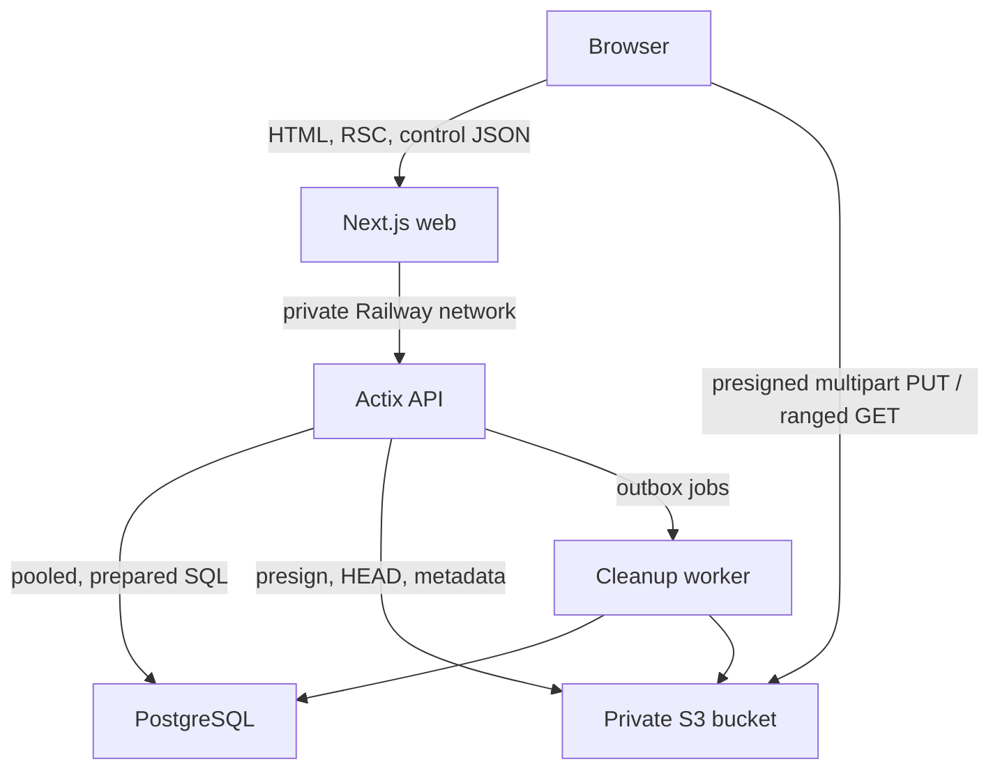

# Aeralyth Performance and Latency Audit

> Audit target: `AdminGodZ/Aeralyth` at commit `35b3278109c905ca1120a0c3cacf534e98d0cb1c` (`35b3278`)  
> Audit date: 2026-07-10  
> Intended production platform: Railway, PostgreSQL, private S3-compatible object storage  
> Scope: Next.js frontend/BFF, Rust/Actix API, PostgreSQL schema and query paths, uploads/downloads, Railway topology, build/deployment, browser runtime, observability, and scale behavior  
> Repository changes: none; this is a read-only review and implementation handoff

## Executive verdict

Aeralyth is not yet ready for the stated “instant” production target. The application has a sound modern base—Next.js App Router, React Server Components, a small Actix service, streamed request bodies, set-based recursive SQL, and request-local React caching—but several architectural bottlenecks dominate those strengths.

The largest problems are not micro-optimizations and not Actix itself:

1. File bytes are still stored on local disk and relayed through both Next.js and Actix. S3 is not implemented.
2. The whole API shares one PostgreSQL connection; common raw-string queries are repeatedly prepared and closed.
3. Every file-list request recursively scans the entire local storage tree synchronously.
4. Visible download actions use `next/link`, so production prefetch/navigation can issue unwanted binary download requests.
5. The production folder-ZIP worker is emitted as raw TypeScript with the wrong MIME type and cannot execute in browsers.
6. File, user, invitation, and several destructive operations are unbounded.
7. One catch-all dashboard route ships upload, settings/color-picker, and admin client code to every dashboard section.

Fixing only CSS, React memoization, Rust compiler flags, or database pool size will not make the current design truly fast. The required sequence is: move the blob data plane directly to S3, pool/cache PostgreSQL work, bound all collections and jobs, collapse request/query duplication, then reduce browser payload and paint cost.

## Release recommendation

**Block production launch until PERF-001 through PERF-006 are resolved and their acceptance tests pass.** PERF-007 through PERF-015 should be completed before opening the service to a large or untrusted user population. The remaining items can follow behind measurements, but should be represented in the production plan.

## Audit method and validation

The review was pinned to the exact commit above, not the moving default branch.

- Reconstructed and inspected the current GitHub source tree and commit history.
- Reviewed all relevant Next.js/React, Rust/Actix, SQL, CSS, package, and deployment files.
- Ran `npm ci --no-audit --no-fund`: 564 packages installed.
- Ran a production Next.js build with the lockfile-resolved Next.js `16.2.10`: build passed.
- Production route classification was verified: `/` is static; `/[section]`, `/api/files/upload`, `/invite/[token]`, and `/login` are dynamic.
- Inspected the generated client-reference manifest and production chunks.
- Started the production Next.js server and fetched the generated ZIP worker artifact to verify its bytes and response headers.
- Cross-checked `next/link` behavior against the installed Next.js 16.2.10 production source. The App Router has no special exclusion for same-origin `/api` links.
- Counted approximately 58 PostgreSQL call sites that pass raw SQL strings and verified `tokio-postgres` raw-string query behavior against its source/documentation.
- `npm run lint` currently fails: 118 errors, 24 warnings, and 10 informational diagnostics. Most are formatting/accessibility rather than measured runtime regressions, but this prevents a clean performance-quality gate.
- Rust compilation was not run because this review environment has no Rust toolchain. PostgreSQL plans and load tests also require a representative running database. These are explicit follow-up gates, not reasons to weaken the confirmed static findings.
- No GitHub Actions workflows or repository-owned production deployment configuration were found. Connector access could not retrieve a useful combined check result for the private commit.

### Measured frontend baseline

These values are a repeatable baseline from this snapshot, not universal framework costs. Hashes and byte counts will change after any build or dependency update.

| Asset/response | Production baseline |
|---|---:|
| Empty `/files` HTML | 81,490 B raw / 13,995 B gzip |
| Modern-browser JS referenced by `/files` | approximately 230,764 B gzip |
| Dashboard feature chunk shared by upload/settings/admin | 221,579 B raw / 65,116 B gzip |
| Dashboard CSS | approximately 19,604 B gzip |
| Three globally preloaded font files | 72,580 B |
| Folder ZIP worker artifact | 2,793 B raw, uncompiled TypeScript |
| Installed `node_modules` in audit environment | approximately 768 MB uncompressed |

The dashboard client-reference manifest assigns `ProfileSettingsForm`, `UploadPanel`, and `UsersContent` to the same chunks for every dashboard section. The shared 65.1 KB-gzip feature chunk contains upload UI, settings color-picker UI, and admin account/dialog UI together.

## Severity and confidence

| Label | Meaning |
|---|---|
| Critical | Release blocker, data-path scalability failure, or production behavior that can create large unexpected work |
| High | Material p95/p99, scale, availability, or browser responsiveness problem |
| Medium | Measurable improvement or important production hardening after the main architecture is fixed |
| Low | Valid optimization that should be driven by measurement rather than launch priority |

“Confirmed” means the behavior is directly present in source or generated production output. “Conditional” means the application lacks a control but Railway or another upstream might currently mask it; it must be measured before changing it.

## Target production architecture



Next.js and Actix should remain the authorization/control plane. They should not relay multi-gigabyte object bodies. PostgreSQL should remain the indexed metadata source; the application should not list or scan S3 to render a folder.

## Priority summary

| ID | Severity | Finding | First fix |
|---|---|---|---|
| PERF-001 | Critical | Local storage and double-proxied blob data path | Direct presigned S3 multipart upload and signed/ranged download |
| PERF-002 | Critical | Synchronous recursive storage scan and blocking file operations | Remove disk scans; transactional usage counters; S3/outbox |
| PERF-003 | Critical | One PostgreSQL connection for the API | Bounded recovering pool with cached statements and timeouts |
| PERF-004 | Critical | Download endpoints rendered as `next/link` | Plain anchors plus presigned redirect; never prefetch blobs |
| PERF-005 | Critical | Production ZIP worker is raw TypeScript | Prebundle worker or verified Webpack fallback; production E2E |
| PERF-006 | Critical | Unbounded list and aggregate paths | Keyset pagination, bounded DTOs, counters |
| PERF-007 | High | Repeated SQL prepare/execute/close round trips | Cached prepared statements / finite statement variants |
| PERF-008 | High | Auth, CSRF, dashboard, and mutation query fan-out | One route bootstrap/auth context and one CSRF check |
| PERF-009 | High | Indexes do not match hot filters/order | Production-shaped plans plus composite/partial indexes |
| PERF-010 | High | Folder upload SQL N+1 | Unique folder constraint, upsert, path cache/batch finalize |
| PERF-011 | High | Upload/profile redirect causes duplicate page work | JSON responses, optimistic update, at most one RSC refresh |
| PERF-012 | High | One dashboard route ships every feature | Concrete routes and route-specific client boundaries |
| PERF-013 | High | ZIP creation is O(archive size) browser memory | Direct per-file multipart or streamed/bounded ZIP path |
| PERF-014 | High | Deletion is synchronous, unbounded, and non-retryable | Short DB transaction plus durable outbox worker |
| PERF-015 | High | No quota reservation or upload admission control | Pending uploads, limits, concurrency guards, reconciliation |
| PERF-016 | High | Original avatars in PostgreSQL with `no-store` | S3 thumbnail variants and immutable versioned caching |
| PERF-017 | High | Password hashing consumes PostgreSQL capacity | Bounded application CPU pool plus rate limits |
| PERF-018 | High | Railway build, port, topology, and migration gaps | Source-controlled two-service deployment and migrations |
| PERF-019 | High | Health always reports OK; no dependency timeouts | Liveness/readiness split, pool/query/lock timeouts |
| PERF-020 | Medium | Maintenance work runs on request/startup paths | Bounded scheduled cleanup |
| PERF-021 | Medium | Global fonts and continuous full-screen paint | Reduce preloads; compositor/static background |
| PERF-022 | Medium | Smaller browser hot-path inefficiencies | Hoist date formatter; simplify login checkbox; lazy dialogs |
| PERF-023 | Medium | Deployment dependency/build footprint | Remove unused runtime deps; standalone/release images |
| PERF-024 | Medium | No performance telemetry or regression gates | Tracing, `pg_stat_statements`, browser/load/chaos tests |
| PERF-025 | Low | Text UUID/hash storage density | Native UUID/BYTEA only if early or proven worthwhile |

---

## Detailed findings

### PERF-001 — Local storage and the blob data path are incompatible with Railway/S3

**Severity:** Critical  
**Status:** Confirmed  
**Confidence:** Very high

#### Evidence

- `backend/src/config.rs:10,29-30` defines only `storage_path`; there is no bucket, region, endpoint, key, or presigning configuration.
- `backend/Cargo.toml:6-18` contains no S3 client dependency.
- Uploads create and write local files in `backend/src/routes/files.rs:217-253`.
- Downloads open local files in `backend/src/routes/files.rs:323-369`.
- Deletion and user cleanup assume local per-user directories in `backend/src/routes/files.rs:619-657` and `backend/src/routes/admin.rs:886-1104`.
- `src/app/api/files/upload/route.ts:42-63` relays the complete browser request through Next.js to Actix.
- `next.config.ts:7-13` rewrites all other `/api/*` traffic, including downloads, through Next.js.
- The current download response has no `Content-Length`, ETag, conditional request, or range implementation.

The Next.js upload proxy streams rather than buffers the complete 2 GB body; that is good and was explicitly checked. The problem is the unnecessary extra full-data hop, lost resumability, connection lifetime, duplicate service bandwidth, and local final storage.

#### Impact

- Railway service filesystems are not durable application storage. A volume would bind storage to a service instance and undermine replica-safe scaling.
- Uploading through replica A and downloading through replica B is unreliable with local files.
- Browser → Next → Actix → disk/S3 and the reverse consume application sockets, CPU, memory buffers, and network capacity for the complete transfer.
- A deployment or transient network failure restarts a monolithic large upload.
- Large downloads cannot efficiently resume or seek.

#### Required design

1. `POST /api/files/uploads` authenticates once, checks CSRF once, validates name/type/declared size/quota/concurrency, reserves quota, and creates a `pending` row.
2. For small files it returns a presigned single PUT. For files at or above a measured threshold—100 MB is a reasonable initial AWS-aligned threshold—it starts multipart upload and returns signed part instructions.
3. The browser uploads directly to the bucket with bounded concurrency, checksums, retry, cancellation, and resume state.
4. `POST /api/files/uploads/{id}/complete` is idempotent. It validates part ETags, performs `CompleteMultipartUpload`, verifies size/checksum with `HeadObject`, and transitions metadata to `active` in a short transaction.
5. `GET /api/files/{id}/download` performs one indexed authorization query and returns a short-lived 302/303 to a presigned S3 GET. Sign `Content-Disposition` and the intended filename. Let S3 provide length, ranges, ETag, and conditional requests.
6. Deletion marks rows `deleting` and enqueues an outbox job; a worker performs batched idempotent object deletes.
7. Lifecycle rules abort incomplete multipart uploads when supported. A scheduled reconciliation job expires abandoned pending rows/reservations and handles providers without lifecycle rules.

Use a private bucket, exact-origin CORS, short URL lifetimes, immutable random object keys such as `users/{owner_uuid}/files/{file_uuid}/{version}`, and never use the user filename as the authorization boundary. Store at least `object_key`, version/ETag, checksum, content type, size, state, and timestamps in PostgreSQL. Instantiate one reusable S3 client in `AppState`.

#### Acceptance tests

- A 1–2 GB upload shows application-service traffic that is control-plane sized; object bytes go browser ↔ S3.
- Interrupt a multipart upload, resume only missing parts, and verify final checksum.
- Upload through API replica A, authorize/download through B, then redeploy both; the object remains available.
- A `Range` request returns 206 from S3 and resumes an interrupted download.
- Killing the API between every presign/upload/finalize/delete boundary never leaves an `active` row pointing to a missing object; stale bytes converge through reconciliation.

Authoritative guidance: [Railway storage buckets](https://docs.railway.com/storage-buckets), [Railway bucket upload/serving patterns](https://docs.railway.com/guides/storage-buckets-guide), [AWS presigned uploads](https://docs.aws.amazon.com/AmazonS3/latest/userguide/PresignedUrlUploadObject.html), [AWS multipart upload](https://docs.aws.amazon.com/AmazonS3/latest/userguide/mpuoverview.html), and [AWS S3 performance/range guidance](https://docs.aws.amazon.com/AmazonS3/latest/userguide/optimizing-performance-guidelines.html).

### PERF-002 — File-list latency grows with the entire storage tree and blocks Actix workers

**Severity:** Critical  
**Status:** Confirmed  
**Confidence:** Certain

#### Evidence

- `backend/src/routes/files.rs:118-145` includes storage statistics in every file-list response.
- `backend/src/routes/files.rs:1293-1351` recursively traverses the storage root using blocking `std::fs` calls.
- The separate storage endpoint repeats the calculation at `backend/src/routes/files.rs:157-161`.
- Upload uses synchronous `std::fs::File` and `write_all` in the async handler at `backend/src/routes/files.rs:217-253`.
- Folder/user deletion and startup cleanup use blocking recursive filesystem operations in `backend/src/routes/files.rs:619-657` and `backend/src/routes/admin.rs:886-1104`.

The local download reader itself uses `tokio::fs`; it is not correct to label every file operation blocking. The write, scan, and removal paths above are the confirmed problems.

#### Impact

- One slow filesystem operation blocks an Actix worker event loop and unrelated requests.
- File-list latency is O(all stored local objects), not O(current page).
- A large upload/delete can drive metadata p95/p99 beyond the Next.js 2.5-second API timeout.
- Scanning S3 instead after migration would still be the wrong design and could add request cost.

#### Fix

- Delete storage-capacity scans from request paths.
- Treat configured user quota and PostgreSQL-maintained usage as application storage state.
- Update usage and count counters transactionally on finalize/purge; trash should normally continue counting until actual purge.
- Add a periodic reconciliation job to detect counter drift without putting it on the request critical path.
- The S3/outbox architecture removes local write/removal work. As a temporary bridge only, use `tokio::fs` for bounded operations and `spawn_blocking` for unavoidable traversal/removal.

#### Acceptance tests

- File-list p95 remains materially flat as total stored objects grow from 100 to 100,000.
- Metadata load during a large upload/delete shows no meaningful event-loop lag or p95 regression.
- No request handler calls recursive filesystem or bucket-list APIs.

### PERF-003 — One PostgreSQL connection serializes the API

**Severity:** Critical  
**Status:** Confirmed  
**Confidence:** Certain

#### Evidence

- `backend/src/db.rs:3-13` creates one `tokio_postgres::Client`.
- `backend/src/state.rs:5-8` stores that client directly in shared application state.
- `backend/src/main.rs:19-35` creates it once for all Actix workers.
- If the connection driver fails, it only logs; it does not reconnect.
- Admin mutations open a new TCP connection per transaction at `backend/src/routes/admin.rs:330-336,391-397,457-463,539-545`.

`tokio-postgres` can pipeline client messages, but PostgreSQL executes work on one backend connection serially. Pipelining does not create database-side concurrency.

#### Impact

- One slow query, password hash, filesystem-adjacent transaction, or lock creates head-of-line blocking for unrelated users.
- The apparent `Promise.all` parallelism in Next.js is largely serialized at PostgreSQL.
- Admin mutations pay fresh connection setup.
- A database restart can leave the API permanently broken while health still reports 200.

#### Fix

- Replace the global client and ad hoc connections with `deadpool-postgres`, SQLx `PgPool`, or an equivalent bounded, recovering pool.
- Cache prepared statements per connection.
- Configure acquire, connect, statement, lock, transaction, idle, and maximum-lifetime controls.
- Size the pool across replicas, not per process in isolation:

  `pool_max_per_replica × replica_count + migration/maintenance reserve < PostgreSQL max_connections`

- A reasonable first staging value is 4–8 connections per API replica, a 500–1000 ms acquire timeout, and short read/lock timeouts, followed by tuning from pool-wait and database-CPU evidence. Do not copy those numbers blindly into every environment.
- Add PgBouncer only when connection pressure warrants it; if transaction pooling is introduced, validate its prepared-statement configuration.
- Put Next.js, Actix, and PostgreSQL in the same Railway region and use Railway private DNS/networking.

#### Acceptance tests

- At 1, 10, 50, and expected peak concurrent users, pool acquire p95 stays below the agreed budget and one slow query does not stall health/auth/file metadata.
- Terminating database connections causes readiness to fail, the pool to reconnect, and traffic to recover without restarting Actix.
- Total database connections remain inside the budget at maximum Railway replica count.

References: [Railway private networking](https://docs.railway.com/networking/private-networking), [`tokio-postgres`](https://docs.rs/tokio-postgres), and [`deadpool-postgres`](https://docs.rs/deadpool-postgres/latest/deadpool_postgres/).

### PERF-004 — Download actions can prefetch or double-request binary files

**Severity:** Critical  
**Status:** Confirmed against source and Next.js 16.2.10 production code  
**Confidence:** Very high

#### Evidence

- `src/features/dashboard/dashboard-shell.tsx:731-739` and `783-791` render `/api/files/{id}/download` with `<Link>` and default prefetch behavior.
- `next.config.ts:7-13` rewrites those URLs into the Rust download path.
- Next.js 16.2.10 observes/prefetches visible same-origin links and does not exclude `/api` URLs. Link clicks are handled as App Router navigation first.

Visible file rows can therefore issue speculative GETs to a binary endpoint. On click, an attempted RSC/navigation GET can be wasted before browser fallback starts the real download. With the planned S3 path this can still consume authorization queries, signed redirects, storage reads, and bandwidth.

#### Fix

- Replace both download `<Link>` instances with a normal `<a href="...">`.
- Prefer a single authorization/control request that redirects to the presigned S3 GET.
- Never prefetch blob, export, archive, or download endpoints. `prefetch={false}` is a defensive alternative, but a plain anchor best expresses browser download navigation.
- Let `Content-Disposition` determine filename; an optional `download` attribute is not a substitute for correct headers across origins.

#### Acceptance tests

- In a production Playwright/network test, leaving `/files` idle produces zero `/download` requests.
- One click produces exactly one control-plane authorization/redirect and one S3 GET; no `_rsc` query or Flight header reaches the download endpoint.
- Scrolling new rows into view produces zero storage reads.

Reference: [Next.js Link API](https://nextjs.org/docs/app/api-reference/components/link).

### PERF-005 — The production ZIP worker is not browser-executable

**Severity:** Critical release blocker  
**Status:** Reproduced from production build  
**Confidence:** Certain

#### Evidence

- Worker construction is in `src/features/dashboard/upload-panel.tsx:203-209`.
- The worker source is `src/features/dashboard/folder-zip.worker.ts` and contains TypeScript-only syntax, bare package imports, and the `@/` path alias.
- The production Turbopack build emitted `.next/static/media/folder-zip.worker.<hash>.ts` as the raw 2,793-byte TypeScript source.
- A production `next start` returned that artifact as `Content-Type: video/mp2t`.
- The emitted file still includes `import type`, TypeScript type declarations, `@zip.js/zip.js`, and `@/...`; a browser module Worker cannot execute it.

This is both a correctness failure and a performance failure: users wait for compression, receive a generic error, and may retry a path that cannot succeed in production.

#### Fix

- Prebundle the worker explicitly with esbuild/Rollup into browser ESM, fingerprint it, and instantiate the emitted JavaScript URL; or temporarily use a verified Webpack production build that correctly handles `new Worker(new URL(...))`.
- Do not pin or switch bundlers solely on assumption. Make the production E2E below the release gate.

#### Acceptance tests

- A production E2E compresses and uploads a tiny folder.
- Worker response is JavaScript MIME, contains no TypeScript syntax or unresolved aliases/bare imports, and logs no worker exception.
- Cancellation terminates worker activity and releases any upload parts.

### PERF-006 — Collections, aggregates, payloads, and DOM work are unbounded

**Severity:** Critical at real account size  
**Status:** Confirmed  
**Confidence:** Certain

#### Evidence

- `backend/src/routes/files.rs:790-978` returns normal files, favorites, trash, and shared files without `LIMIT`; only the recent subquery limits to 50.
- `backend/src/routes/files.rs:1009-1054` scans/aggregates all owned files on every listing.
- `backend/src/routes/admin.rs:714-802` fully materializes users and invitations.
- `src/lib/api.tsx:142-157,359-400` has no cursor/page contract.
- `src/features/dashboard/dashboard-shell.tsx:391-412` maps every file entry.
- `src/features/dashboard/users-content.tsx:123-141,281-334,369-394` filters/maps complete arrays and hydrates them into a Client Component.
- Each rendered row repeats form and CSRF markup.

#### Impact

Database work, sort memory, JSON/RSC/HTML bytes, serialization, DOM nodes, hydration, avatar requests, search cost, and mutation markup all grow without bound. Adding OFFSET pagination later would still degrade on deep pages.

#### Fix

- Add stable keyset pagination, normally 50–100 rows per page, to files, users, and invitations.
- Return `items`, `nextCursor`, and `hasMore`; encode the selected sort value plus a stable ID tie-breaker.
- Implement server-side search/sort for admin lists.
- Keep summary counters separate from page rows and maintain/calculate them outside the critical list query.
- Use view-specific DTOs instead of many fields that are always null/false.
- Virtualize only if the product deliberately keeps hundreds of rows mounted; pagination is the primary bound.

Suggested file cursor orders:

- Name: folder rank, `lower(original_name)`, `id`
- Size: folder rank, `size_bytes`, `lower(original_name)`, `id`
- Updated: view-specific timestamp, `lower(original_name)`, `id`
- Shared: `file_shares.created_at`, `file_id`

#### Acceptance tests

- With 100,000 files and several thousand entries in one folder, one response never exceeds page size and latency/bytes remain bounded.
- With 1,000 users, DOM rows remain page-sized and search is server-side.
- Cursors produce no duplicates or omissions across equal names, sizes, and timestamps.
- p75 INP remains under 200 ms on the target client class.

### PERF-007 — Raw SQL strings add repeated protocol and planning work

**Severity:** High  
**Status:** Confirmed  
**Confidence:** High

#### Evidence

Approximately 58 `.query`, `.query_one`, `.query_opt`, and `.execute` call sites pass raw SQL strings. Examples include `backend/src/auth.rs:34-61` and `backend/src/routes/files.rs:840-844,1009-1043`. There is no reusable `Statement` or statement cache.

For the audited `tokio-postgres` API, a raw string is converted into a statement through prepare, execute, and close; its documented `query_typed` path exists specifically to avoid those three round trips. A dashboard request already runs several logical queries, so protocol latency multiplies quickly even on a private network.

#### Fix

- Use the selected pool's cached preparation support—SQLx statement cache or `deadpool-postgres::prepare_cached`—for every finite hot statement.
- Convert dynamic sort strings to a finite set of validated/prepared variants.
- Keep the current normalized sort whitelist; it is not a SQL injection issue.
- Track query count and server planning/execution time separately with `pg_stat_statements`.

#### Acceptance tests

- A common file listing executes the intended number of logical statements without prepare/close on every request.
- Compare protocol round trips, `pg_stat_statements` planning time, and endpoint p95 before/after.

### PERF-008 — Dashboard/auth/CSRF flows perform avoidable work

**Severity:** High  
**Status:** Confirmed  
**Confidence:** High

#### Evidence

- `src/features/dashboard/dashboard-session.ts:8-12` calls `/auth/me` and `/auth/csrf` in parallel.
- `src/app/(dashboard)/[section]/page.tsx:64-82` also starts files/admin data in parallel.
- The data endpoint authenticates the session again through `backend/src/auth.rs:66-102`.
- Mutations commonly call `require_user`/`require_admin`, then `require_csrf`, causing two session queries before business SQL.
- Upload supplies CSRF in both query/body paths and can validate it twice: `src/features/dashboard/upload-panel.tsx:79-105`, `backend/src/routes/files.rs:170-200`.
- Admin transactions can validate again on a fresh connection.
- `backend/src/routes/files.rs:123-145` then performs folder validation, breadcrumb, entries, summary, and filesystem storage stats sequentially.

`Promise.all` already avoids a JavaScript serial waterfall, and React `cache()` correctly deduplicates layout/page calls to `getDashboardSession` within one RSC render. Do not remove those good properties or claim the calls occur twice each.

#### Fix

- Create one backend authentication extractor/context that loads user ID, role, and session CSRF token once per API request.
- Send CSRF in `X-CSRF-Token`, not a URL; compare it from the already-loaded session row.
- For dashboard navigation, expose a route-specific bootstrap endpoint that returns user, CSRF, requested page rows, breadcrumbs, and needed summary after one session lookup. Do not return unrelated sections.
- Collapse safe resource authorization and business work into prepared CTE/`INSERT ... SELECT` statements where it reduces round trips without obscuring invariants.
- Keep last-admin safety checks inside the authoritative transaction, but remove redundant preliminary validation.
- Preserve private `no-store` behavior for cookie-bound mutable data; never add cross-user Next.js caching.

#### Acceptance tests

- Distributed trace shows one session query per backend request.
- Common mutation target: one auth/CSRF query plus one business statement.
- File-list target after counters/pagination: no more than two or three prepared logical statements, absent an exceptional path.
- CSRF tokens never appear in query strings or access logs.

### PERF-009 — Existing indexes do not match the principal filters and ordering

**Severity:** High at scale  
**Status:** Confirmed query/index mismatch; exact index set requires plans  
**Confidence:** High

#### Evidence

`database/init/001_auth.sql:172-186` creates mostly global single-column indexes. Hot queries filter by owner/recipient, parent, state, entry type, and favorite, then order by name/size/update/share time. Case-insensitive user lookups use `lower(username)`, but `users.username` has only a case-sensitive unique index. `UNIQUE(file_id, recipient_id)` already creates an index beginning with `file_id`, making `file_shares_file_id_idx` redundant.

Session/invitation token unique indexes, foreign-key support, `files.parent_id` for recursive traversal, and the pending invitation username expression index are already appropriate. Do not add redundant point-lookup indexes such as `(id, owner_id, state)` ahead of the primary key.

#### Candidate migration

Validate every candidate with production-shaped `EXPLAIN (ANALYZE, BUFFERS)` before and after. Syntax assumes PostgreSQL 15+; use versioned migrations and build large indexes concurrently when required. `CREATE INDEX CONCURRENTLY` cannot run inside a transaction, so give concurrent index builds a dedicated non-transactional migration/release step supported by the chosen runner.

```sql
-- Prefer canonical lowercase usernames. If not, enforce CI uniqueness.
CREATE UNIQUE INDEX CONCURRENTLY users_username_ci_uq
  ON users (lower(username));

-- Prevent duplicate active folders, including root parent NULL on PG15+.
CREATE UNIQUE INDEX CONCURRENTLY files_active_folder_name_uq
  ON files (owner_id, parent_id, lower(original_name)) NULLS NOT DISTINCT
  WHERE state = 'active' AND entry_type = 'folder';

-- Rewrite folder ordering to match `(entry_type = 'folder') DESC`.
-- Split root (`parent_id IS NULL`) and child (`parent_id = $2`) query variants.
CREATE INDEX CONCURRENTLY files_active_browse_name_idx
  ON files (
    owner_id,
    parent_id,
    ((entry_type = 'folder')) DESC,
    lower(original_name),
    id
  )
  WHERE state = 'active';

CREATE INDEX CONCURRENTLY files_recent_owner_idx
  ON files (owner_id, updated_at DESC, id)
  WHERE state = 'active';

CREATE INDEX CONCURRENTLY files_favorites_owner_idx
  ON files (owner_id, updated_at DESC, id)
  WHERE state = 'active' AND favorite;

CREATE INDEX CONCURRENTLY files_trash_owner_idx
  ON files (owner_id, trashed_at DESC, id)
  WHERE state = 'trashed';

CREATE INDEX CONCURRENTLY file_shares_recipient_created_idx
  ON file_shares (recipient_id, created_at DESC, file_id);

CREATE INDEX CONCURRENTLY invitations_pending_expiry_idx
  ON invitations (expires_at)
  WHERE status = 'pending';
```

After replacements are proven, inspect `pg_stat_user_indexes` before considering removal of redundant/low-selectivity `file_shares_file_id_idx`, `files_state_idx`, `files_favorite_idx`, `files_updated_at_idx`, or `invitations_status_idx`.

User-selected size/update folder sorts may justify additional indexes only if telemetry shows enough use and large enough folders; do not create a wide index for every UI option by default.

#### Acceptance tests

- Store plan fixtures for realistic cardinalities/skew and assert index-backed, bounded plans.
- Deep cursor pages do not scan or sort all earlier rows.
- Concurrent creation of the same root/nested folder yields one row.

References: [PostgreSQL partial indexes](https://www.postgresql.org/docs/current/indexes-partial.html), [indexes and `ORDER BY`](https://www.postgresql.org/docs/current/indexes-ordering.html), and [using `EXPLAIN`](https://www.postgresql.org/docs/current/using-explain.html).

### PERF-010 — Folder uploads produce O(files × path depth) SQL work

**Severity:** High  
**Status:** Confirmed  
**Confidence:** Certain

- `backend/src/routes/files.rs:261-269` resolves every uploaded file's path segments.
- `backend/src/routes/files.rs:736-787` SELECTs and may INSERT every segment.
- The schema has no uniqueness constraint preventing concurrent duplicate folders.

Add the active-folder uniqueness constraint from PERF-009, replace SELECT-then-INSERT with `INSERT ... ON CONFLICT ... RETURNING id`, and cache resolved paths within a batch. Under direct S3, create/batch folder metadata separately from object bytes so query count scales with unique folders, not files × depth.

**Acceptance:** a 1,000-file upload with repeated nested paths performs O(unique folders) folder operations and never creates duplicate folder rows under concurrency.

### PERF-011 — Successful upload/profile mutations render the target page twice

**Severity:** High for upload; medium-high for profile  
**Status:** Confirmed  
**Confidence:** Certain

#### Upload evidence

- `src/features/dashboard/upload-panel.tsx:111-125` waits for XHR completion and calls `window.location.assign(request.responseURL)`.
- The Next upload proxy preserves upstream redirects in `src/app/api/files/upload/route.ts:15-20,50-63`.
- Rust returns a 303 after upload in `backend/src/routes/files.rs:310-320`.

XHR follows the 303, causing Next.js to render `/files` and the XHR to download its otherwise-unused response before `load` fires. `window.location.assign` then requests and hydrates `/files` again.

#### Profile evidence

- `src/features/dashboard/profile-settings-form.tsx:153-168` uses `fetch` with redirect-follow behavior.
- Rust returns a 303; the code discards the followed response body and then calls `router.refresh()`.

Frequent file/admin actions also use native forms in `dashboard-shell.tsx:704-819` and throughout `users-content.tsx`, producing full document navigation for favorite/trash/restore/account changes.

#### Fix

- When `Accept: application/json` is present, return `200/201/204` JSON such as `{ item, location, version }`, never a form redirect.
- Keep 303 only for native no-JavaScript form fallback if desired.
- Update the row/list optimistically with rollback and perform at most one targeted `router.refresh()` when server data cannot be patched locally.
- Direct multipart upload naturally ends with a JSON finalize request.

#### Acceptance tests

- Upload: no redirected HTML request; one finalize POST and at most one RSC refresh.
- Profile: one POST, no followed HTML, at most one RSC refresh.
- Frequent row mutations do not trigger document navigation and update immediately.

### PERF-012 — The catch-all dashboard route prevents useful client-code isolation

**Severity:** High  
**Status:** Confirmed by production manifest  
**Confidence:** Very high

#### Evidence

- `src/app/(dashboard)/[section]/page.tsx:4` imports monolithic dashboard rendering.
- `src/features/dashboard/dashboard-shell.tsx:32-36` statically imports sidebar, `ProfileSettingsForm`, `UploadPanel`, `UserPreferenceHydrator`, and the roughly 1,075-line `UsersContent`.
- Runtime branching at `dashboard-shell.tsx:263-290` chooses a section too late for route-level code isolation.
- The dashboard layout also imports its frame from the monolithic module.
- Production client-reference output assigns the settings, upload, and admin components the same client chunks for all sections. `/files` receives code containing settings color picker, upload, and admin account actions.

#### Fix

- Extract a minimal `dashboard-frame.tsx` used by the layout; it must not import section features.
- Replace the catch-all implementation with concrete route pages (`/files`, `/recent`, `/favorites`, `/shared`, `/trash`, `/settings`, `/users`, etc.) or another structure that creates real route-specific module graphs.
- Import only the route's Client Components. Dynamically load interaction-only color pickers and complex admin dialogs if the analyzer still shows them on initial navigation.
- Do not merely create route files while the layout still imports the monolith.

#### Acceptance tests

- The `/files` client-reference manifest and browser coverage contain no `@uiw`, `users-content`, admin dialog/select, or profile settings modules.
- `/settings` contains neither `UploadPanel` nor `UsersContent`.
- Set a post-split gzip budget in CI; a provisional `/files` modern-JS target below 180 KB gzip is reasonable, then calibrate against product needs and devices.

### PERF-013 — Client ZIP creation can exhaust browser memory

**Severity:** High  
**Status:** Confirmed algorithm/memory shape  
**Confidence:** High

- `src/features/dashboard/folder-zip.worker.ts:41-84` writes to a `BlobWriter` and materializes the complete output archive.
- `src/features/dashboard/upload-panel.tsx:231-257` checks the final archive cap only after compression and wraps the result as a new `File`.
- `folder-zip.worker.ts:55-74` posts every progress callback; each message updates React state at `upload-panel.tsx:219-228`.

The output alone can approach 2 GB in memory; source `File` handles and compression overhead coexist. `useWebWorkers:false` inside the outer worker is intentional and should not be “fixed” by nesting more workers.

#### Fix

- Prefer direct per-file S3 multipart uploads with folder paths represented as metadata, eliminating the need for a ZIP transport.
- If a ZIP product feature remains, stream output to multipart S3 or the File System Access API where supported.
- Otherwise preflight a conservative, measured device-safe size well below 2 GB and provide a server-side asynchronous archive option for large folders.
- Throttle progress messages to animation frame or roughly 5–10 Hz.

#### Acceptance tests

- Multi-gigabyte folder workflows never grow browser memory O(total archive size).
- Cancellation releases the worker and any multipart state.
- Progress state updates occur no more than the chosen throttle.

### PERF-014 — Destructive operations are synchronous, unbounded, and not retry-safe

**Severity:** High at scale  
**Status:** Confirmed  
**Confidence:** Certain

- Folder delete loads every descendant storage key into memory at `backend/src/routes/files.rs:619-640`, commits metadata, then synchronously removes files while ignoring failures at `642-657`.
- User delete holds a transaction/advisory lock while staging storage and performs recursive filesystem work at `backend/src/routes/admin.rs:542-598,886-1027`.

PostgreSQL and S3 cannot participate in one atomic transaction. Use a short database transaction to mark metadata `deleting` and insert durable outbox rows. A separate worker should batch `DeleteObjects`, retry with bounded exponential backoff, make work idempotent, and finalize/tombstone metadata only after convergence. Large database cascades may also require bounded batches.

**Acceptance:** delete a very large tree while normal metadata p99 and lock duration remain bounded; inject object-store failures and verify retries converge without resurrecting or leaking active files.

### PERF-015 — Upload admission, quota reservation, and orphan cleanup are incomplete

**Severity:** High  
**Status:** Confirmed  
**Confidence:** Certain

- The 2 GB limit is per file field in `backend/src/routes/files.rs:18,232-246`.
- There is no bounded file count, total request size, per-user aggregate quota, concurrent-upload limit, global admission limit, pending state, or quota reservation.
- Process death/cancellation can leave bytes without metadata.

The upload-init endpoint must atomically reserve declared quota and enforce file-count, total-size, user concurrency, and global capacity. Track `pending`, expiry, multipart ID, and idempotency key. Finalize moves reserved → used bytes; abort/expiry releases reservation. Add per-user and global semaphores/rate limits, fast 429/503 responses, lifecycle cleanup, and reconciliation.

**Acceptance:** abort at each phase and verify no active metadata plus eventual byte/reservation cleanup; flood upload-init and prove resource use remains bounded.

### PERF-016 — Avatars are oversized database blobs and deliberately uncacheable

**Severity:** High on admin/list pages  
**Status:** Confirmed  
**Confidence:** Certain

- `database/init/001_auth.sql:24-39` stores up to 2 MB of avatar bytes in `users`.
- `backend/src/routes/profile.rs:248-280` and `backend/src/routes/admin.rs:602-640` query and return the original bytes.
- Both respond `Cache-Control: private, no-store` despite versioned URLs created at `backend/src/auth.rs:156-165` and `backend/src/routes/admin.rs:725-752`.
- Admin user avatars in `src/features/dashboard/users-content.tsx:290-293` are eager and not async-decoded.

This creates roughly two queries per avatar in current authorization paths, serialized through one connection, and can transfer a 2 MB original for a 32 px display.

#### Fix

- Resize and metadata-strip uploads into small 64/128/192 or 256 px WebP/AVIF/JPEG variants.
- Store variants in S3 and only key/version/checksum/MIME/size in PostgreSQL.
- Use versioned immutable keys and `private, max-age=31536000, immutable`, or a suitable signed/CDN design consistent with access policy.
- Add `loading="lazy" decoding="async"` for offscreen admin avatars.
- Do not blindly add Next Image for protected endpoints whose optimizer fetch lacks the user cookie; correct source bytes and cache policy are the primary fixes.

#### Acceptance tests

- Repeat navigation transfers 0 B or validates with 304 and performs no database blob read.
- Admin list loads only viewport/page avatars and decoded dimensions are close to display needs.

### PERF-017 — Password hashing consumes shared PostgreSQL capacity

**Severity:** High availability/tail-latency risk  
**Status:** Confirmed  
**Confidence:** High

- Login verifies with PostgreSQL `crypt` in `backend/src/auth.rs:53-58`.
- Account creation/invitation acceptance hashes inside PostgreSQL at `backend/src/routes/admin.rs:278-289` and `backend/src/routes/invitations.rs:89-120`.
- No login rate limit or bounded hashing concurrency is present.

Password hashing is intentionally expensive. On the current sole connection it blocks all database work; after pooling, floods can still consume database CPU.

Select the hash by indexed canonical username, release the DB connection, and verify/hash in a bounded application blocking CPU pool using a tuned Argon2id policy (with a measured migration path for existing bcrypt hashes). Add per-IP and per-account rate limiting plus a hash semaphore. Do not reduce cost merely to improve login latency.

**Acceptance:** a login-flood test does not materially raise ordinary metadata p99 or PostgreSQL CPU beyond the defined budget.

### PERF-018 — Railway deployment and schema evolution are not reproducible from the repository

**Severity:** High production-readiness gap  
**Status:** Confirmed repository gap  
**Confidence:** Certain; Railway dashboard may contain undocumented settings

#### Evidence

- No `Dockerfile`, `railway.toml`, Nixpacks plan, or per-service build configuration is present.
- Root `package.json` builds/starts only Next.js; backend scripts use debug `cargo run`.
- `backend/src/config.rs:15-19` reads `AERALYTH_API_PORT` but not Railway's injected `PORT`.
- `next.config.ts` lacks `output: "standalone"`.
- `next.config.ts:3,7-13` resolves the rewrite origin while config is evaluated at build time. If the private API origin is not present during the Railway build, browser `/api` rewrites can embed the localhost default even though server-side API helpers read their origin at runtime.
- Only `database/init/001_auth.sql` exists; Docker initialization does not migrate a Railway PostgreSQL database.
- The monolithic SQL seeds `admingod/admingod` at `001_auth.sql:188-190`.

#### Fix

- Define two source-controlled Railway services from the repository:
  - Web: production Next build/start, public domain, runtime origin/private API configuration.
  - API: multistage `cargo build --locked --release`, nonroot minimal image, private-only domain/network.
- Read `PORT`, keeping `AERALYTH_API_PORT` only as an explicit local override.
- Use `output: "standalone"` when containerizing Next.js and copy traced server, static, and public assets. If using Railway's native builder instead, still document exact build/start/environment behavior.
- Replace build-time generic binary rewrites with a runtime BFF/proxy where necessary, or guarantee the private origin during build and test the generated routes.
- Keep Next, Actix, and PostgreSQL in the same Railway project/region; use `api.railway.internal`/private DNS and the private `DATABASE_URL`. Keep the bucket as geographically close as practical.
- Do not attach a volume to the API and do not deploy multi-region API replicas around one single-region primary database.
- Add ordered versioned migrations (`sqlx migrate`, Refinery, or equivalent), an advisory-lock migration runner/pre-deploy step, and production-safe concurrent index creation.
- Remove the default admin seed; implement explicit one-time bootstrap.
- Pin the PostgreSQL major version in development/production documentation.

Railway private networking is encrypted, so `NoTls` is not automatically a problem on that internal path. If PostgreSQL is reached publicly, configure TLS.

#### Acceptance tests

- Fresh Railway environment from source alone creates both services, migrates an empty database, binds the injected random `PORT`, and passes readiness.
- Generated production web config never targets `127.0.0.1`.
- The API is private, diskless, release-built, and survives replica/redeploy tests.

References: [Next.js self-hosting](https://nextjs.org/docs/app/guides/self-hosting), [Next.js standalone output](https://nextjs.org/docs/pages/api-reference/config/next-config-js/output), and [Railway private networking](https://docs.railway.com/networking/private-networking).

### PERF-019 — Health, timeouts, and backpressure do not reflect dependency state

**Severity:** High tail-latency/availability risk  
**Status:** Confirmed  
**Confidence:** Certain

- `backend/src/routes/health.rs:16-28` always returns 200 and only reports whether configuration strings exist.
- A dead PostgreSQL connection is only logged in `backend/src/db.rs:6-9`.
- No pool acquire, statement, lock, idle-transaction, or explicit expensive-operation admission controls are configured.
- `src/lib/api.tsx:175-205` aborts ordinary Next→Actix calls after 2.5 seconds; synchronous backend work may remain uncancelable.

Keep a cheap process/event-loop liveness endpoint. Add readiness with a short pool checkout and `SELECT 1`; optionally include a cached/shallow S3 client/config dependency signal rather than doing a network object operation on every probe. Configure pool acquisition, statement, lock, idle transaction, request/body, and graceful shutdown behavior. Align timeouts so the outer Next timeout is not shorter than an uninterruptible inner operation; after the S3 redesign, object transfer should have progress/idle semantics independent of control-plane JSON.

**Acceptance:** kill DB connections, hold locks, and inject slow S3/control operations. Readiness fails quickly, liveness remains correct, resources stay bounded, and service recovers without restart.

### PERF-020 — Cleanup work runs on latency-sensitive paths

**Severity:** Medium  
**Status:** Confirmed  
**Confidence:** Certain

- Every successful login deletes expired sessions at `backend/src/routes/auth.rs:76-80`.
- Admin reads/mutations expire invitations at `backend/src/routes/admin.rs:123-140,1107-1115`.
- Startup scans tombstones and performs sequential database/storage cleanup before binding at `backend/src/main.rs:22` and `backend/src/routes/admin.rs:1057-1104`.

Move expiry, tombstones, reconciliation, and orphan cleanup to scheduled/background jobs. Batch work, cap run time, retry, and monitor rows/dead tuples. A request can treat expired records as expired in its predicate without synchronously cleaning the whole table.

### PERF-021 — Global font preloads and full-screen background paint add avoidable critical-path work

**Severity:** Medium for fonts; medium-low/device-dependent for paint  
**Status:** Confirmed bytes and paint-triggering property  
**Confidence:** High

- `src/app/layout.tsx:2,8-21,41-49` globally instantiates Figtree, Geist, and Geist Mono.
- The production build preloads three font files totaling 72,580 B on every route. Mono is used for a small amount of label/ID text.
- `src/app/globals.css:170-213` animates `background-position` forever on two very large pseudo-elements with `inset: -42%`, causing continuous paint on login/invite surfaces.
- `prefers-reduced-motion` handling at `globals.css:371-383` is correct and should remain.

Keep at most two globally preloaded families, or set mono `preload: false` and scope it to routes that need it. `next/font` is self-hosted; there is no runtime Google request to “fix.” For the dotted surface, prefer a static tile or compositor-friendly transform on a bounded pre-rendered layer, then verify with Paint Flashing/Performance on a low-end mobile target. Measure backdrop filters before changing them.

### PERF-022 — Smaller browser hot-path inefficiencies

**Severity:** Medium-low/Low  
**Status:** Confirmed  
**Confidence:** High

1. `dashboard-shell.tsx:961-972` and `users-content.tsx:1062-1073` instantiate `Intl.DateTimeFormat` per row/date. Hoist one formatter per locale/module or memoize by locale.
2. `login/page.tsx:212-224` uses a Client Radix checkbox for one basic form field. The page-specific checkbox/related chunks are approximately 14.7 KB gzip in this build. A styled native checkbox can remove this critical-login client dependency while preserving semantics.
3. `[section]/loading.tsx:1-12` is a Client Component only for `usePathname`. Concrete routes allow route-specific Server Component loading skeletons.
4. After route splitting, lazy-load complex admin/color dialogs on first interaction if bundle analysis still justifies it.

These are valid savings, but they should not delay PERF-001 through PERF-019.

### PERF-023 — Runtime dependency and production image footprint are larger than necessary

**Severity:** Medium for deployment/cold build; low for request latency  
**Status:** Confirmed package/source mismatch  
**Confidence:** High

- `gsap`, `@gsap/react`, and `react-doctor` have no source imports.
- `shadcn` is tooling/build-time; the stylesheet import means it may still be needed during build, not in the pruned runtime image.
- A TypeScript 6 alias plus a TypeScript 7 package and `postinstall` rebuild adds install/tooling complexity.
- Audit install produced 564 packages and approximately 768 MB uncompressed `node_modules`.

Remove genuinely unused packages, move build-only tooling to dev dependencies, and remove the TypeScript 7 alias/rebuild if no documented workflow requires it. Use Next standalone tracing or an equivalent pruned runtime image and a Rust release multistage image. Unused packages are normally tree-shaken from browser chunks; do not claim `gsap` is currently downloaded by users. The benefit is install time, image size, supply-chain surface, and deploy/cold-start behavior.

Actix JSON compression is not installed (`backend/src/main.rs` wraps only `Logger`). After pagination, test whether Railway/Next already compresses the relevant end-to-end responses. Add Actix `Compress` only if the measured response lacks suitable compression; never recompress object bodies.

### PERF-024 — There is no performance observability or regression gate

**Severity:** Medium now; High before scale  
**Status:** Confirmed  
**Confidence:** Certain

Default request logging cannot explain p95/p99 or prevent regressions. Add:

- End-to-end request IDs and OpenTelemetry spans across browser/Next → Actix → PostgreSQL/S3.
- Endpoint p50/p95/p99, response bytes, active requests, event-loop/worker saturation, errors, and timeout metrics.
- Pool wait/utilization, query count/duration, transaction/lock duration, and reconnect metrics.
- S3 init/sign/finalize/HEAD/delete/retry latency; pending uploads and stale outbox age.
- PostgreSQL `pg_stat_statements`, slow-query logging, and controlled `auto_explain` in staging.
- Next bundle analysis in CI and production Playwright network assertions.
- Web Vitals reporting segmented by route/device/network.

Suggested initial budgets, to be calibrated after representative staging tests:

| Metric | Initial gate |
|---|---:|
| LCP p75 | ≤ 2.5 s |
| INP p75 | ≤ 200 ms |
| CLS p75 | ≤ 0.1 |
| Warm dashboard TTFB p95 | ≤ 300 ms |
| Metadata API p95 / p99 | ≤ 150 ms / 350 ms |
| Pool acquire p95 / p99 | < 10 ms / < 50 ms |
| Common mutation acknowledgement p95 | ≤ 200 ms, excluding object transfer |
| Object bytes through Next/Actix | 0 on normal upload/download data path |
| Idle `/files` download requests | 0 |
| Initial `/files` modern JS | provisional < 180 KB gzip after route split |

Load/chaos scenarios should include 1/10/50/100 concurrent users; 100, 10,000, and 100,000 file metadata rows; very large single folders; 1,000 admin users; 10 MB/1 GB uploads; failed multipart parts; database reconnects; row locks; bucket throttling; and replica/redeploy transitions.

### PERF-025 — Text identifiers and hashes reduce database cache density

**Severity:** Low/Medium depending scale and migration cost  
**Status:** Confirmed representation  
**Confidence:** High

UUID-looking primary/foreign keys are stored as `TEXT`, and SHA-256 digests as 64-character hex text rather than 32-byte `BYTEA`. This enlarges tables/indexes and comparisons. If production data is not yet established, native `UUID` and binary digests are worth considering now. The default non-UUID seed ID makes conversion nontrivial. If data already exists, measure `pg_relation_size`, cache hit rate, and query time before accepting the migration risk. Do not prioritize UUID flavor/allocator tuning ahead of the data-plane, pooling, pagination, and indexes.

---

## AI implementation plan

The following order minimizes rework and provides explicit stopping points.

### Phase 0 — Correctness and data-plane release blockers

1. **Fix download UI immediately** in `src/features/dashboard/dashboard-shell.tsx`: replace download `Link` with `<a>` and add the no-prefetch production network test.
2. **Fix the ZIP worker build**: explicitly bundle it or switch to a production path proven by E2E. Do not continue feature work until production folder compression executes.
3. **Create versioned migrations** for S3 metadata/state, pending uploads, quota reservation, and outbox jobs. Remove default production credentials.
4. **Add an object storage abstraction and reusable S3 client** to Rust application state.
5. **Implement upload-init, multipart signing, idempotent completion, abort, reconciliation, and signed download redirect.** Update the browser to direct S3 transfers.
6. **Remove local storage scans and request-time local file operations.** Keep local storage only as an explicit development adapter if needed.

### Phase 1 — Database concurrency and bounded work

7. Replace the single `Client` and per-admin connections with a bounded recovering pool.
8. Add cached prepared statements and finite statement variants; configure pool/query/lock timeouts.
9. Add one auth/CSRF request context and route-specific dashboard bootstrap contract.
10. Add keyset pagination for files/users/invitations and split summary/counters from page rows.
11. Add folder uniqueness/upsert/path cache.
12. Seed representative data; run plans; add only verified composite/partial indexes; remove redundant indexes only after usage evidence.
13. Move delete, expiry, and reconciliation to bounded jobs/outbox.
14. Move password hashing to a bounded application CPU pool and add login/admission rate limits.

### Phase 2 — Browser and perceived latency

15. Return JSON for JavaScript mutations; remove redirect-follow/double-render paths; use optimistic row updates.
16. Split the dashboard frame from route features and create route-specific module graphs.
17. Move avatars to versioned S3 thumbnail variants with caching/lazy decoding.
18. Replace or bound client ZIP creation; throttle progress.
19. Reduce font preloads, hoist date formatters, and replace the login-only Radix checkbox if bundle evidence remains favorable.
20. Change the dotted animation only after paint profiling confirms the compositor/static replacement.

### Phase 3 — Reproducible Railway operations and enforcement

21. Add source-controlled Web/API release builds, injected `PORT`, private origins, health/readiness, graceful shutdown, and migration command.
22. Add end-to-end tracing, pool/S3/database metrics, `pg_stat_statements`, and slow-plan tooling.
23. Add CI: build, lint, Rust fmt/clippy/test, migrations, bundle budget, Playwright, worker/download network checks, API integration, and load-test smoke gate.
24. Run full staging load/chaos tests before enabling replicas. Scale horizontally only after the API is diskless and database pool budget is proven.

## Proposed API and state contracts

These names are suggestions; preserve existing product naming where practical.

```text
POST   /api/files/uploads
       -> { fileId, mode, objectKey, uploadId?, partSize?, signedUrl(s), expiresAt }

POST   /api/files/uploads/{fileId}/parts
       body { partNumbers[] }
       -> short-lived signed part URLs (allows resume without signing thousands at once)

POST   /api/files/uploads/{fileId}/complete
       body { parts: [{ partNumber, etag, checksum? }] }
       -> { file, quota, version }

DELETE /api/files/uploads/{fileId}
       -> 204; idempotently abort and release reservation

GET    /api/files/{fileId}/download
       -> 302 Location: short-lived presigned S3 GET

GET    /api/dashboard/{view}?cursor=...&limit=...
       -> { user, csrfToken, items, breadcrumbs, summary, nextCursor, hasMore }
```

Suggested state invariant:

```text
pending -> completing -> active -> deleting -> deleted/tombstoned
    |           |                      |
    +---------> failed <---------------+
```

- Only `active` objects appear in normal listings or can be downloaded.
- Quota is reserved for `pending/completing`, used for `active/deleting`, and released only after an abort/confirmed purge.
- Completion and deletion are idempotent.
- Outbox/reconciliation guarantees eventual convergence across the PostgreSQL/S3 transaction boundary.

## File-by-file handoff map

| File/area | Required changes |
|---|---|
| `src/features/dashboard/dashboard-shell.tsx` | Plain download anchors; paged rows; optimistic frequent mutations; split monolith/frame |
| `src/features/dashboard/upload-panel.tsx` | Direct S3 multipart client; CSRF header; no redirect; bounded concurrency/resume; worker fix |
| `src/features/dashboard/folder-zip.worker.ts` | Explicit production bundling or replace with streamed/bounded design; throttle progress |
| `src/features/dashboard/profile-settings-form.tsx` | JSON save response; no followed redirect; S3 thumbnail path |
| `src/features/dashboard/users-content.tsx` | Server pagination/search; lazy avatars/dialogs; optimistic mutations; shared formatter |
| `src/features/dashboard/dashboard-session.ts` | Preserve React cache; consume combined/bootstrap response |
| `src/app/(dashboard)/[section]/*` | Concrete route module graphs and server loading boundaries |
| `src/app/api/files/upload/route.ts` | Remove binary relay after direct S3; retain only small control-plane BFF if useful |
| `src/lib/api.tsx` | Cursor DTOs, bootstrap DTO, aligned structured timeouts, runtime private origin |
| `next.config.ts` | Safe runtime/private proxy strategy; optional standalone output; verify no baked localhost |
| `src/app/layout.tsx` | Reduce global font preload count |
| `src/app/globals.css` | Compositor/static dotted background after profiling |
| `backend/src/state.rs` | Pool, reusable S3 client, admission controls, observability handles |
| `backend/src/db.rs` | Recovering pool, connection settings, cached statements |
| `backend/src/config.rs` | Railway `PORT`, S3/pool/timeout/quota settings with production validation |
| `backend/src/auth.rs` | One auth/CSRF context; indexed username lookup; external bounded password verify |
| `backend/src/routes/files.rs` | S3 control plane, pagination/cursors, counters, prepared queries, outbox deletion; no disk scan |
| `backend/src/routes/admin.rs` | Pool transactions, pagination/search, async deletion/cleanup, no DB avatars |
| `backend/src/routes/profile.rs` | S3 processed avatar metadata/response; JSON mutation semantics |
| `backend/src/routes/health.rs` | Separate liveness/readiness |
| `backend/src/main.rs` | Middleware, graceful shutdown, compression if measured, background worker wiring |
| `database/*` | Ordered migrations, S3 state/outbox/quota schema, verified indexes, remove default seed |
| deployment files | Reproducible Railway web/API release builds, migration command, health paths, private topology |

## Explicitly checked non-issues and cautions

These were reviewed to reduce false positives:

- The Next upload route streams; it does not hold a 2 GB request in memory. The extra hop/resume architecture is the issue.
- Local downloads stream asynchronously; they are not fully loaded into RAM.
- Multipart file bodies are processed chunk-by-chunk. The per-file limit is real; aggregate/admission limits are missing.
- Profile-image buffering is bounded to 2 MB. The storage/cache/original-size pattern is the issue.
- React `cache()` deduplicates the layout/page dashboard session function within one RSC render.
- Next auth/files/admin calls are already started in parallel. Their count, duplicate authentication, single DB connection, and all-or-nothing response are the issue—not a JavaScript serial waterfall.
- Private mutable data correctly uses dynamic/no-store behavior. Do not globally cache it across users.
- Next fonts are self-hosted. Optimize preload count, not a nonexistent Google runtime request.
- Named Lucide imports are optimized by current Next.js; no blanket icon rewrite is justified.
- ThemeProvider receiving Server Component children does not automatically convert the full tree into a Client Component.
- ZIP is intended to load in a Worker, not the initial main thread. `useWebWorkers:false` inside the outer worker is correct. The raw TypeScript production artifact and whole-Blob memory shape are the actual findings.
- Session and invitation token hashes have unique indexes, and hashing is applied to parameters rather than indexed columns.
- Foreign-key columns and recursive `files.parent_id` already have support.
- Trash/restore use set-based recursive SQL rather than one SQL query per descendant.
- Dynamic sort SQL selects from normalized finite values; no SQL-injection finding is asserted.
- No application `Mutex`/`RwLock` hot spot was found.
- Actix default worker count is not the root cause. More workers would mask blocking work, not fix it.
- `NoTls` is acceptable only on Railway's encrypted private network; it is not an automatic finding there.
- The current CSS bundle is not a priority. The specific continuously painted background is the measured concern.
- Unused dependencies are not assumed to be in browser JS; their confirmed cost is install/image/deployment footprint.
- Rust release mode is normally well optimized by default. LTO, allocator swaps, and buffer micro-tuning should wait for profiles.
- Do not add a CDN or multi-region replicas ahead of a single-region PostgreSQL primary without an explicit consistency/latency design.

## Definition of done

Aeralyth can reasonably be called production-ready and performance-optimized when all of the following are true:

- Application services are diskless and no normal object bytes traverse Next.js or Actix.
- Multipart upload resumes, ranged download works, and S3/DB failure-boundary tests converge without orphaned active state.
- File list idle produces zero download requests; one click produces one authorization redirect plus one object GET.
- Production folder compression either works through a compiled JavaScript worker or has been replaced.
- PostgreSQL uses a bounded recovering pool and cached statements; query count/pool wait are traced.
- File/user/invitation pages and destructive jobs have hard bounds independent of account size.
- Hot query plans and indexes are proven on production-shaped data.
- Dashboard client code is route-specific and within a CI budget.
- Redirect-follow duplicate renders are removed; frequent mutations are optimistic and bounded.
- Avatars are processed, versioned, cached object variants rather than database originals.
- Railway port, private topology, release builds, migrations, readiness, graceful shutdown, and secrets are source-controlled/reproducible.
- Production-like load, browser, reconnect, lock, upload interruption, and deployment transition tests pass the agreed p95/p99 and Web Vitals budgets.
- Build, lint, Rust checks, migrations, bundle assertions, and critical production E2E tests run in CI.

## Primary references

- [Next.js self-hosting](https://nextjs.org/docs/app/guides/self-hosting)
- [Next.js deployment and Node server](https://nextjs.org/docs/app/getting-started/deploying)
- [Next.js standalone output](https://nextjs.org/docs/pages/api-reference/config/next-config-js/output)
- [Next.js Link behavior](https://nextjs.org/docs/app/api-reference/components/link)
- [Railway private networking](https://docs.railway.com/networking/private-networking)
- [Railway storage buckets](https://docs.railway.com/storage-buckets)
- [Railway storage bucket upload/serving guide](https://docs.railway.com/guides/storage-buckets-guide)
- [AWS S3 performance guidelines](https://docs.aws.amazon.com/AmazonS3/latest/userguide/optimizing-performance-guidelines.html)
- [AWS multipart upload overview](https://docs.aws.amazon.com/AmazonS3/latest/userguide/mpuoverview.html)
- [AWS abort incomplete multipart lifecycle rule](https://docs.aws.amazon.com/AmazonS3/latest/userguide/mpu-abort-incomplete-mpu-lifecycle-config.html)
- [`tokio-postgres` documentation](https://docs.rs/tokio-postgres)
- [`deadpool-postgres` documentation](https://docs.rs/deadpool-postgres/latest/deadpool_postgres/)
- [PostgreSQL partial indexes](https://www.postgresql.org/docs/current/indexes-partial.html)
- [PostgreSQL ordering indexes](https://www.postgresql.org/docs/current/indexes-ordering.html)
- [PostgreSQL plan inspection](https://www.postgresql.org/docs/current/using-explain.html)

---

**Handoff note for the implementing AI:** preserve behavior and security invariants while changing transport. Start by adding tests for current semantics, then implement in the phase order above. Do not attempt to “optimize everything” in one unreviewable patch. Each phase should include migrations, rollback/compatibility, instrumentation, and its acceptance tests before proceeding.
